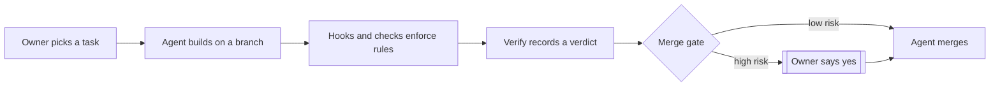

# agent-harness

A harness that runs AI coding agents under machine-checked rules, with a merge gate that holds risky changes for a person.

This is a public snapshot of a private harness (`dot-agent`) that one person
uses every day with Claude Code. Personal and work-specific parts were removed;
the rules, hooks, checks, merge gate, skills and repo template are intact.
Inside the code it still calls itself `dot-agent` and installs to `~/.dot-agent`.

## Status

| | |
|---|---|
| Version | 2.27.0 |
| Works | Claude Code setup (Opus 5.5, Sonnet 5.5), merge gate, four hooks, scheduled hunter, repo template 2 |
| Next | smaller wiki skill, verdict check when a PR opens |

## Why it exists

Agents write code fast, but a rule written only in a prompt is a rule they can
forget. Here every rule that matters lives in one table, `CONSTRAINTS.tsv`, and
names the code that enforces it and the test that proves the enforcer works.
Agents may merge low-risk work on their own; anything touching setup, hooks,
CI, the rules, credentials or outside actions waits for the owner's recorded yes.

## How it works

1. **Rules.** [CONSTRAINTS.tsv](CONSTRAINTS.tsv) lists each rule with its level
   (impossible > check > test > hook > prose), its enforcer and its proof.
   `scripts/check-constraints.py` fails if an enforcer goes missing or a prose
   rule is reworded away. [AGENTS.md](AGENTS.md) holds the judgment rules.
2. **Hooks and checks.** Claude Code hooks deny a push to main, ask before any
   send or share, and require one outcome line per finished reply. A git
   pre-commit hook and CI run [scripts/check](scripts/check): manifests, lint,
   private-data scan, diagram and README rules, then the test suites.
3. **Verify.** The [verify skill](skills/engineering/verify/SKILL.md) runs five
   layers (checks, contract, live, review, verdict) and pins a PASS or BLOCKED
   verdict to the exact commit with `verdict.py`.
4. **Merge gate.** [merge-gate.py](claude/hooks/merge-gate.py) denies
   `gh pr merge` unless checks are green, the head has a PASS verdict with no
   open BLOCKING finding, and a high-risk PR carries the owner's recorded yes.

A correction made twice becomes a new row, proven by a test that fails on the
real past mistake (the [correct skill](skills/engineering/correct/SKILL.md)).
Skills such as `/owner-mode`, `/verify`, `/deslop`, Arena, Unslop and
`show-me` are listed in [owner-mode](skills/engineering/owner-mode/SKILL.md).

## Where to look

| For | Go to |
|---|---|
| Every enforced rule and its proof | [CONSTRAINTS.tsv](CONSTRAINTS.tsv) |
| How a change is proven | [VERIFY.md](VERIFY.md) |
| What changed in each version | [RELEASES.md](RELEASES.md) |
| The one command that checks everything | `scripts/check --tests` |
| Words and their one meaning | [GLOSSARY.md](GLOSSARY.md) |
| The starter files any repo can copy | [template/](template/README.md) |

Needs Python 3.10+. Clone to `~/.dot-agent`, then `./setup.sh --runtime claude`
([runtime reference](docs/harness-runtime-reference.md)).

## How this was built

Measured on the private source repo at the snapshot commit: 324 merged pull
requests, 356 commits on main, version 2.27.0 (its release notes hold 64 entries
back to 1.36.0), 83 rules in `CONSTRAINTS.tsv`, and 345 Python tests plus 2
TypeScript tests. Almost all of it was written by Claude Code agents working
inside the harness itself, each change passing the same checks and merge gate.

Author: Ash Pyakurel. MIT licensed ([LICENSE](LICENSE)); third-party skills keep theirs.
