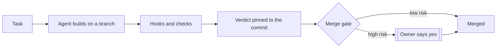

# agent-harness

A harness that runs AI coding agents under machine-checked rules, with a merge gate that holds risky changes for a person.

Every rule lives in [CONSTRAINTS.tsv](CONSTRAINTS.tsv) with the code that
enforces it and the test that proves it. Agents merge low-risk work themselves;
anything touching setup, hooks, CI, rules or credentials waits for the owner's
recorded yes. Judgment rules are in [AGENTS.md](AGENTS.md).

A public snapshot of a private harness used daily with Claude Code. Needs
Python 3.10+. Clone to `~/.dot-agent`, then run `./setup.sh --runtime claude`.
MIT licensed.

## Status

| | |
|---|---|
| Version | 2.27.0 |
| Works | Claude Code setup, merge gate, hooks, repo template |
| Next | verdict check when a PR opens |
