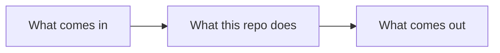

# REPO

One line: what this repo is for and who uses it.

## Status

| | |
|---|---|
| Version | 0.1.0 |
| Works | `<what works today, in a few words>` |
| Next | `<the next outcome>` |

## How it works

Where to look for everything else is the table in [AGENTS.md](AGENTS.md);
what changed is in [RELEASES.md](RELEASES.md).
